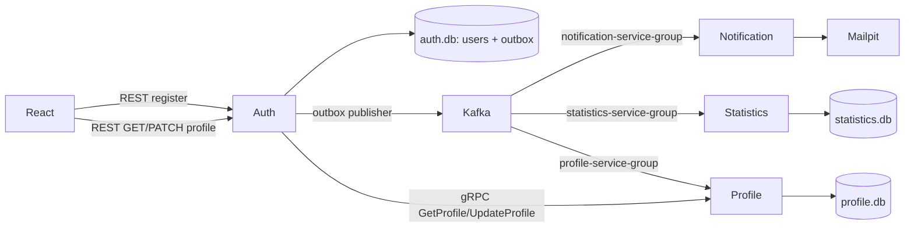

# Microservices QA Lab

Локальный учебный стенд показывает полный путь регистрации через REST API, transactional outbox, Kafka и три независимых consumer-сервиса. Profile Service создаёт профиль по Kafka-событию, а Auth читает и обновляет его по gRPC. Настоящие внешние интеграции не используются: письма остаются в локальном Mailpit.

Подробная инструкция нового сервиса, схема БД и практика Postman: [Profile Service: gRPC и Protobuf](docs/profile-service.md).

## Быстрый старт

Требования: Docker Desktop с Compose v2, 6 ГБ свободной памяти и свободные порты из таблицы ниже.

```bash
cp .env.example .env
docker compose up --build
```

Первый запуск загружает образы и может занять несколько минут. Готовность сервисов:

```bash
docker compose ps
curl -fsS http://localhost:8000/ready
curl -fsS http://localhost:8001/ready
curl -fsS http://localhost:8002/ready
```

## Адреса

| Компонент | Адрес | Назначение |
|---|---|---|
| Frontend | http://localhost:5173 | Регистрация и профиль |
| Auth Swagger | http://localhost:8000/docs | REST API и demo endpoint |
| Notification Swagger | http://localhost:8001/docs | Consumer и fault injection |
| Statistics Swagger | http://localhost:8002/docs | Consumer и fault injection |
| Profile Operations | http://localhost:8003/docs | Health, metrics, задержка gRPC и пауза consumer |
| Profile gRPC | `localhost:50051` | `qa.profile.v1.ProfileService`, Postman, без TLS в локальном стенде |
| Kafka UI | http://localhost:8080 | Топики, события, groups и lag |
| Mailpit | http://localhost:8025 | Перехваченные письма |
| Grafana | http://localhost:3000 | `admin` / `admin`, dashboard `Registration flow` |
| Prometheus | http://localhost:9090 | Метрики и targets |
| auth.db | http://localhost:8085 | Read-only SQLite UI |
| statistics.db | http://localhost:8086 | Read-only SQLite UI |
| profile.db | http://localhost:8087 | Read-only SQLite UI профилей |

Файлы `data/auth.db`, `data/notifications.db`, `data/statistics.db` и `data/profile.db` также можно открыть в DBeaver. Все контейнеры обращаются друг к другу по DNS-именам Compose (`kafka`, `mailpit`, `profile-service`), а не через `localhost`.

## Обновление существующего стенда

После получения обновлений репозитория выполните из корня проекта:

```bash
docker compose up --build -d
docker compose ps
```

Не удаляйте `data` и не запускайте `make clean` для обновления. Profile Service создаст собственную БД автоматически. Для старых пользователей профиль появится только если событие регистрации ещё доступно в Kafka и новая группа его прочитает. При отсутствии истории используйте новую регистрацию для занятия. Данные Auth автоматически в Profile не копируются.



## Успешная регистрация

Через браузер откройте http://localhost:5173/register и используйте, например, `student@example.com` / `Password123`. Кнопка блокируется на время запроса, после `201 Created` откроется `/profile`.

Через API:

```bash
curl -i http://localhost:8000/api/v1/register \
  -H 'Content-Type: application/json' \
  -H 'X-Trace-ID: lesson-success-001' \
  -d '{"email":"student2@example.com","password":"Password123"}'
```

После ответа API асинхронно проверьте:

1. `users` и `outbox_events` в auth SQLite UI; статус outbox станет `PUBLISHED`.
2. `user.registered.v1` и обе consumer groups в Kafka UI.
3. Одно письмо в Mailpit со ссылкой на demo confirmation endpoint.
4. Одну запись в `registration_events` в statistics SQLite UI.
5. В Grafana задайте `trace_id=lesson-success-001` на dashboard `Registration flow`.

Ответ `201` не означает, что письмо и статистика уже обработаны. Проверяйте ожидаемый результат polling-ом по интерфейсам и lag, без фиксированного `sleep`.

## Ошибки API и UI

Невалидные данные (`400`):

```bash
curl -i http://localhost:8000/api/v1/register \
  -H 'Content-Type: application/json' \
  -d '{"email":"bad-email","password":"short"}'
```

Повторите успешный запрос с тем же email для `409 EMAIL_ALREADY_EXISTS`. В UI эти ответы отображаются разными модальными окнами; ошибки `400` также отмечают соответствующие поля. Для сетевой ошибки временно остановите auth-service, оставив frontend запущенным:

```bash
docker compose stop auth-service
# отправьте форму в браузере
docker compose start auth-service
```

## Fault injection

Эти endpoints существуют только при `DEMO_MODE=true` и небезопасны для production.

```bash
# Три попытки следующего письма завершатся ошибкой, затем событие уйдёт в DLQ
curl -X POST http://localhost:8001/internal/demo/fail-next-email

# Три попытки следующей записи статистики завершатся ошибкой
curl -X POST http://localhost:8002/internal/demo/fail-next-statistics-write

# Пауза и продолжение consumer-а: наблюдайте рост lag в Kafka UI
curl -X POST http://localhost:8001/internal/demo/pause-consumer
curl -X POST http://localhost:8001/internal/demo/resume-consumer

curl -X POST http://localhost:8002/internal/demo/pause-consumer
curl -X POST http://localhost:8002/internal/demo/resume-consumer

# Повторить FAILED outbox-записи немедленно
curl -X POST http://localhost:8000/internal/demo/retry-outbox
```

Для сценария недоступной Kafka остановите брокер, зарегистрируйте нового пользователя и снова запустите Kafka. Пользователь и `NEW`/`FAILED` outbox останутся в SQLite, publisher доставит событие после восстановления:

```bash
docker compose stop kafka
# выполните POST /api/v1/register
docker compose start kafka
```

## Идемпотентность и DLQ

Consumer offsets подтверждаются вручную только после успешной обработки или публикации исчерпавшего retry события в `user.registered.dlq.v1`. Notification-service хранит `event_id` в `sent_notifications`; statistics-service атомарно пишет `registration_events` и `processed_events`. Повторное событие с тем же `event_id` не создаёт второе письмо или строку статистики.

Fault endpoint вооружает ровно три ошибки обработки следующего события. После третьей ошибки исходный payload и безопасная причина публикуются в DLQ, offset исходного сообщения подтверждается, а метрика `dlq_messages_total` увеличивается.

## Как локализовать ошибку

1. Скопируйте `X-Trace-ID` из ответа API или `trace_id` из JSON ошибки.
2. Найдите outbox-запись в `auth.db`: `NEW/FAILED` указывает на publisher/Kafka, `PUBLISHED` подтверждает доставку брокеру.
3. В Kafka UI проверьте событие, состояние `notification-service-group` и `statistics-service-group`, offsets и lag.
4. В Grafana откройте dashboard `Registration flow`, введите `trace_id`; для конкретного consumer-а используйте `event_id`.
5. Если lag нулевой, но результата нет, проверьте ERROR/retry/DLQ panel и топик `user.registered.dlq.v1`.
6. Для письма сопоставьте `event_id` с `sent_notifications`; для статистики — с `processed_events`.

7. Для профиля проверьте `profile-service-group`, `profile.db` и `GET /api/v1/profile` с Bearer token. `404 PROFILE_NOT_READY` означает отсутствие профиля, `503 PROFILE_UNAVAILABLE` — недоступность gRPC, `504 PROFILE_TIMEOUT` — превышение deadline. Учётная запись при этом не удаляется.

Типовые границы: нет пользователя — auth/validation; пользователь есть, outbox не опубликован — Kafka publisher; статистика есть, письма нет — notification/SMTP; письмо есть, статистики нет — statistics/SQLite.

## Метрики и логи

Prometheus опрашивает `/metrics` четырёх сервисов каждые 5 секунд. Grafana автоматически получает datasources Prometheus и Loki и dashboard со скоростью регистраций, ошибками API, outbox, результатами consumer-ов, DLQ и log panels. Метрики Profile: `grpc_server_requests_total{method,status}`, `grpc_server_duration_seconds`, `profiles_created_events_total`; их можно исследовать через Explore/PromQL. Логи gRPC доступны в Loki по `{service="profile-service"}`.

Сервисы пишут JSON только в stdout. Обязательные correlation-поля присутствуют в каждой прикладной записи. Пароль, password hash, access token и полное тело запроса не логируются. Stack trace включён только при `ENVIRONMENT=development`.

## Тесты

Автотесты покрывают backend validation/outbox/event contract/idempotency, настоящий gRPC transport и reflection, авторизацию и deadlines, frontend form/modal/profile components и Docker-dependent integration.

```bash
make test-backend
make test-frontend

# При уже запущенном Compose-стенде
python3 -m pip install -r tests/requirements.txt
make test-integration
```

Frontend production build:

```bash
docker compose build frontend
```

## Остановка и очистка

Остановить контейнеры, сохранив SQLite-файлы:

```bash
docker compose down
```

Удалить контейнеры, volumes и локальные учебные данные:

```bash
make clean
```

## Замечания по безопасности

Это учебный стенд. `sessionStorage` выбран для прозрачности упражнения; production-приложению предпочтительнее HttpOnly Secure cookie, CSRF-защита, ротация секретов и полноценная модель авторизации. Access token нельзя передавать в URL, выводить в UI или писать в логи. Demo endpoints следует отключать через `DEMO_MODE=false`.
